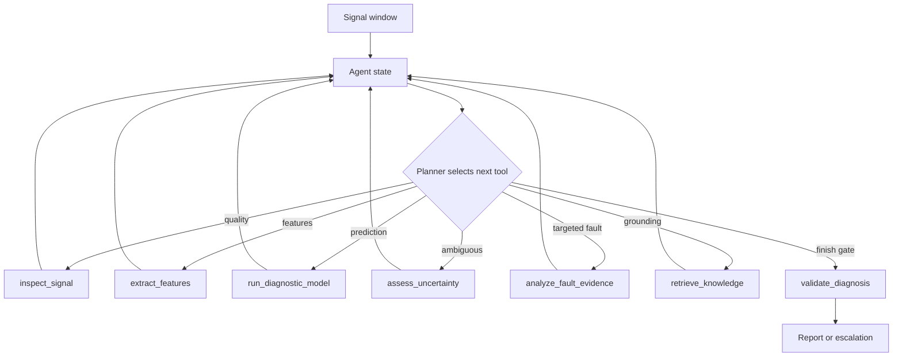

# Industrial Fault Diagnosis Agent

An evidence-grounded Agent for permanent-magnet synchronous motor (PMSM) fault diagnosis. It turns a signal window into a validated engineering report through a traceable tool workflow:



The quickstart uses deterministic synthetic signals, so the repository runs without private research data, an API key, or a hosted model. The transparent classifier is deliberately an adapter seam. An optional ONNX classifier adapter is included; private artifacts stay outside Git.

## Natural-language requests

The runtime now accepts an operator request in Chinese or English and normalizes it into a typed `TaskRequest`. The request can name a CSV, set a confidence threshold, ask for evidence, and focus on a fault family. The language layer only selects task parameters; it cannot invoke arbitrary tools or bypass the existing validation gate.

```bash
python -m industrial_fault_agent.cli ask \
  --request "分析 data/demo/phase_open_window.csv，如果置信度低于0.8就不要下结论并给出证据" \
  --pretty
```

`RuleBasedTaskParser` is the offline default. The recommended cloud parser is `DeepSeekTaskParser`, which uses DeepSeek's OpenAI-compatible endpoint and requires only `DEEPSEEK_API_KEY` outside the repository:

```bash
pip install -e ".[llm]"
$env:DEEPSEEK_API_KEY = "your-key"  # PowerShell; never commit this value
python -m industrial_fault_agent.cli ask --parser deepseek --request "分析 data/demo/phase_open_window.csv，如果置信度低于0.8就不要下结论并给出证据" --pretty
```

Set `FAULT_AGENT_PARSER=deepseek` to make DeepSeek the CLI default after configuring the key. The response is parsed as JSON and validated against the same `TaskRequest` schema before it reaches the Agent. If the key or network is unavailable, use `--parser rules` for the deterministic offline parser. `OpenAITaskParser` remains available for other OpenAI-compatible endpoints. The deterministic planner remains the local fallback. `LLMPlanner` can propose only a registered, currently available tool, and the executor continues to own preconditions, evidence checks, and escalation.

## Why this is an Agent project

The system is more than a classifier. It executes a goal-driven state/action loop with a tool registry. At each step the planner scores applicable tools from the current state, chooses one action, observes the result, and replans. A normal case skips targeted analysis; sensor-bias and interturn candidates trigger different evidence tools. The Agent records its decisions, retrieves domain knowledge, and refuses to issue a confident diagnosis when quality gates fail.

## Quick start

```bash
python -m venv .venv
.venv\\Scripts\\activate       # Windows
pip install -e .
python -m industrial_fault_agent.cli --fault phase_open --pretty
python -m industrial_fault_agent.evaluate
python -m unittest discover -s tests -v
python scripts/run_demo.py --input data/demo/phase_open_window.csv --output reports/demo_phase_open.json
```

Example output includes `fault_family`, `confidence`, `severity`, `evidence`, `recommended_action`, `tool_trace`, and `decision_trace`. The CLI accepts `normal`, `phase_open`, `interturn_short`, `demagnetization`, and `sensor_bias`.

## Model adapter

`run_diagnostic_model` in `src/industrial_fault_agent/tools.py` defines the model output contract. To connect a real model, keep the output shape:

```python
{"label": "phase_open", "confidence": 0.93,
 "class_probabilities": {...}, "model": "pmsm-tcn-v6.2"}
```

The adapter should load a frozen artifact, record its version, and never bypass `validate_diagnosis`. Private data and model binaries belong outside this repository; use `data/private/` locally (it is ignored by Git).

### Real PA-JC-HMT-TCN integration

The repository now includes a MATLAB bridge for the real frozen `TCN_V2` dlnetwork in `matlab/predict_pa_jc_hmt_tcn.m` and a Python adapter in `src/industrial_fault_agent/matlab_adapter.py`. Keep the `.mat` artifact on the local machine and point the adapter at it:

```python
import numpy as np
from industrial_fault_agent import FaultDiagnosisAgent
from industrial_fault_agent.matlab_adapter import MatlabPAJCTCNAdapter

adapter = MatlabPAJCTCNAdapter(
    r"C:\\path\\to\\TCN_V2\\seed_51001\\development_network.mat",
    matlab_executable=r"D:\\ruanjian\\Matlab r2026a\\bin\\matlab.exe",
)
window = np.loadtxt("standardized_window_15x500.csv", delimiter=",")
report = FaultDiagnosisAgent().diagnose_pa_jc(window, adapter)
print(report.to_dict())
```

The adapter enforces the model contract: standardized shape `15x500`, channel order `i1a,i1b,i1c,i2a,i2b,i2c,i3a,i3b,i3c,rd1,rq1,rd2,rq2,rd3,rq3`, and finite values. It calls MATLAB's `dlnetwork/predict` with the three real heads (`fault_softmax`, `module_softmax`, `severity_sigmoid`) and returns the seven fault classes, module, severity, scores, and model name. See `docs/pa_jc_integration.md` for provenance and preprocessing requirements.

An optional ONNX inference adapter is available in `src/industrial_fault_agent/onnx_adapter.py` (`pip install -e '.[onnx]'`). The adapter accepts `[channels, samples]` and currently provides the generic classifier contract. Connecting the existing PA-JC-HMT-TCN requires an export with a documented channel order, normalization statistics, output class order, and treatment of its multitask heads; those details must match the frozen training pipeline exactly.

## Evaluation

`python -m industrial_fault_agent.evaluate` runs one reproducible case per reference fault family and reports accuracy, confidence, and tool-call count. For a serious model comparison, add grouped splits by complete operating condition, report macro-F1, calibration, latency, and failure/escalation rate. Do not use overlapping windows across train and test sets.

## Repository map

| Path | Purpose |
|---|---|
| `src/industrial_fault_agent/agent.py` | Orchestration and evidence report |
| `src/industrial_fault_agent/natural_language.py` | Natural-language task parsing, CSV loading, and request runner |
| `src/industrial_fault_agent/tools.py` | Typed diagnostic tools and quality gate |
| `src/industrial_fault_agent/synthetic.py` | Reproducible reference data generator |
| `src/industrial_fault_agent/evaluate.py` | Offline evaluation harness |
| `scripts/run_demo.py` | CSV quickstart entry point |
| `data/demo/` | Deterministic reference inputs |
| `matlab/` | PA-JC-HMT-TCN MATLAB inference bridge |
| `docs/model_card.md` | Data, use, and limitation statement |
| `.github/workflows/test.yml` | Reproducible CI checks |
| `tests/` | Regression tests for accuracy, traceability, and refusal behavior |

## Limitations and safe use

This release is an engineering prototype, not a safety-certified protection system. Reference signatures are intentionally simple. A production deployment must validate against held-out machine data, include operating-condition coverage, monitor drift, and keep a qualified engineer in the decision loop.

## Roadmap

1. Add a local document retriever for manuals and experiment notes with source citations.
2. Add latency, calibration, grouped cross-condition evaluation, and a small web service.
